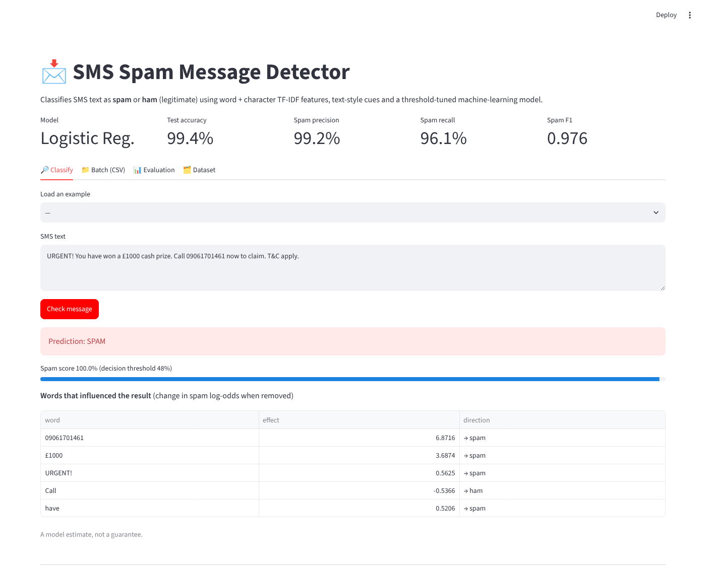
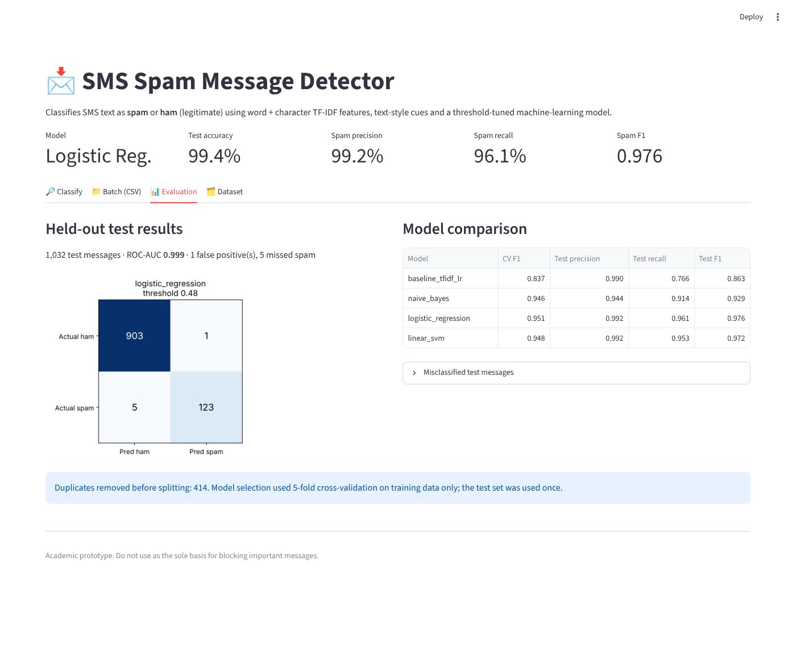

# SMS Spam Message Detector
## AIML Minor Project Report

**Student:** [PRIYA VART KUMAR PRIYANSHU]  
**ERP:** [6606467]  
**Course / Branch:** [BTECH CSE]  
**Semester:** [5TH]  
**Institute:** [RUNGTA COLLEGE OF ENGG TECH]  

## Abstract
SMS spam can expose users to scams, unwanted advertising, and fraudulent links. This project develops a supervised machine-learning prototype that classifies a text message as spam or legitimate (ham). The text is represented with Term Frequency–Inverse Document Frequency (TF-IDF) features. Word and character n-gram TF-IDF features are combined with hand-crafted text cues, and Multinomial Naive Bayes, Logistic Regression and a calibrated Linear SVM are compared by 5-fold cross-validation on training data. The selected model (Logistic Regression) has its decision threshold tuned for high spam precision and is evaluated once on a held-out test set of 1,032 unique messages, reaching 99.4% accuracy, 99.2% spam precision, 96.1% spam recall and a spam F1 of 0.976. The model is served through a Streamlit dashboard with word-level explanations and batch scoring, and through a command-line tool. A data-leakage problem in the original design (414 duplicate messages shared between train and test) was found and corrected.

## 1. Introduction
Short-message services remain useful for personal communication and notifications, but they are also used for unsolicited promotions and fraud attempts. A rule-only filter may fail when message wording changes. Machine-learning classification can learn patterns from labelled examples and generalize to some unseen messages. This project demonstrates a compact, reproducible text-classification pipeline.

## 2. Problem statement
To design and implement a user-friendly application that predicts whether an input SMS resembles spam or legitimate messages, and to evaluate the model on unseen labelled examples.

## 3. Objectives
- Prepare labelled text data for supervised learning.
- Convert raw text into TF-IDF feature vectors.
- Compare Naive Bayes and Logistic Regression.
- Evaluate classification performance using multiple metrics.
- Provide a simple interactive web interface.
- Document limitations and responsible use.

## 4. Scope
The prototype focuses on English SMS text and a binary spam/ham label. It does not verify URLs, sender identity, phone numbers, or real-time threat intelligence. It should not automatically delete or block messages.

## 5. Dataset
Use the SMS Spam Collection dataset from the UCI Machine Learning Repository. It contains labelled messages. The application expects a CSV with `label` and `message` columns, where label is `spam` or `ham`. The full dataset is bundled in `data/SMSSpamCollection.csv` (see `data/README_DATA.md`). It has 5,574 rows (4,827 ham, 747 spam). Of these, 414 are exact duplicate messages; they are removed, leaving 5,160 unique messages (4,518 ham, 642 spam). Duplicates must be removed before splitting, otherwise identical texts appear in both train and test and inflate the scores.

## 6. Tools and technologies
- Language: Python
- Data processing: pandas
- Machine learning: scikit-learn
- Text representation: word and character TF-IDF plus text-style cues
- Interface and charts: Streamlit and Matplotlib
- Model persistence: joblib

## 7. Methodology
### 7.1 Data preparation
Rows with missing label or message are removed, labels are normalized to `spam` and `ham`, and exact duplicate messages are dropped. A stratified 80/20 split (random seed 42) gives 4,128 training and 1,032 test messages with the same class proportions.

### 7.2 Feature extraction
Three feature groups are concatenated:
- **Word TF-IDF** with unigrams and bigrams. Stop words are kept because words such as *now*, *free* and *call* are strong spam signals.
- **Character TF-IDF** (2–5 character n-grams inside word boundaries), which is robust to obfuscation such as `fr33` or `txt4`.
- **Style cues:** presence of a URL, a long digit string (phone/short code), a currency symbol, urgency-word count, upper-case ratio, digit ratio, exclamation marks and message length.

All vectorizers are fitted inside a scikit-learn Pipeline, so only training text is used when fitting and test vocabulary never leaks.

### 7.3 Models
**Multinomial Naive Bayes:** a probabilistic text classifier (word features only).
**Logistic Regression:** a linear model with class-balanced weights and probability output.
**Linear SVM (calibrated):** a margin-based linear model with probabilities from sigmoid calibration.
The original word-TF-IDF Logistic Regression is kept as a **baseline** for comparison.

### 7.4 Model selection and threshold tuning
Each candidate is scored with stratified 5-fold cross-validation on the training set only. The candidate with the best out-of-fold spam F1 is selected. Its decision threshold is then tuned on the out-of-fold probabilities to maximize F1 subject to spam precision of at least 98%, because wrongly blocking a legitimate message is costlier than missing a spam. The test set is used once, for the final report. The deployed model is the same recipe refit on all 5,160 messages.

### 7.5 Evaluation
- **Accuracy:** fraction of all predictions that are correct.
- **Precision (spam):** fraction of predicted spam messages that are truly spam.
- **Recall (spam):** fraction of actual spam messages detected.
- **F1-score (spam):** harmonic mean of spam precision and recall.
- **ROC-AUC:** ranking quality independent of the threshold.
- **Confusion matrix:** counts true/false predictions for each class.

## 8. System architecture
Input SMS → word TF-IDF + character TF-IDF + style cues → Logistic Regression → spam probability → tuned threshold (0.48) → spam/ham label with word-level explanation → Streamlit dashboard or command line.

## 9. Implementation
- `spam_detector/core.py`: data loading and cleaning, feature pipeline, candidate models, prediction and occlusion-based explanations (shared by every entry point).
- `train_model.py`: cross-validated model comparison, threshold tuning, final evaluation, and saving the model plus `metrics.json`, `model_comparison.csv`, `classification_report.txt`, `confusion_matrix.png` and `misclassified.csv` to `outputs/`.
- `app.py`: Streamlit dashboard that loads the saved model at start-up (training once automatically if it is missing). Tabs: classify a message with explanation, batch CSV scoring with download, evaluation, dataset.
- `predict.py`: command-line single and batch prediction.
- `tests/test_core.py`: unit tests for data cleaning, predictions, edge-case input and a quality floor.

Explanations remove each word in turn and report the change in spam log-odds, which works with any model and stays informative when the score is saturated near 0% or 100%.

## 10. Results
Test set: 1,032 unique messages (904 ham, 128 spam), never used for model or threshold selection.

| Metric | Value |
|---|---|
| Dataset rows after cleaning | 5,160 (from 5,574; 414 duplicates removed) |
| Train examples | 4,128 |
| Test examples | 1,032 |
| Selected model | Logistic Regression (word + char TF-IDF + style cues), threshold 0.479 |
| Accuracy | 99.4% |
| Spam precision | 99.2% |
| Spam recall | 96.1% |
| Spam F1-score | 0.976 |
| ROC-AUC | 0.999 |

Confusion matrix: 903 true ham, 1 false positive, 5 false negatives, 123 true spam.

### 10.1 Model comparison
| Model | CV spam F1 (tuned) | Test precision | Test recall | Test F1 |
|---|---|---|---|---|
| Baseline: word TF-IDF + LR (original) | 0.837 | 0.990 | 0.766 | 0.863 |
| Multinomial Naive Bayes | 0.946 | 0.944 | 0.914 | 0.929 |
| **Logistic Regression** | **0.951** | 0.992 | 0.961 | **0.976** |
| Linear SVM (calibrated) | 0.948 | 0.992 | 0.953 | 0.972 |

The upgrade lifts spam recall from 76.6% to 96.1% at the same precision. The original code reported F1 0.925, but that figure was inflated by duplicate messages appearing in both train and test; on the de-duplicated split the same model scores 0.863. The test set holds only 128 spam messages, so one split can differ from the next by a point or two. The cross-validated F1 of 0.951 is the more conservative figure; the three upgraded models are close to one another.

### 10.2 Screenshots

### 10.3 Error analysis
The single false positive is a legitimate message from a social site that quotes "send FREE SMS" and "sms NO", wording typical of promotions. The five missed spam messages are atypical: a conversational "dating" message, two adult-content messages, a stock-pump promotion, and a subscription-service reply that reads like an ordinary notification. They avoid the usual urgency, prize and phone-number cues. All are listed in `outputs/misclassified.csv`.

## 11. Limitations
- Performance depends on the dataset and may decline on new slang, languages, or changing scam tactics.
- A probability/score is not a guarantee that a message is malicious.
- A model may learn dataset-specific patterns.
- The application does not scan URLs or verify senders.
- The dataset is small (5,160 unique messages) and dates from the mid-2000s, so current scams may look different.

## 12. Future enhancements
- Add multilingual text support and more recent labelled data.
- Retrain on larger and more recent labelled data and re-tune the threshold for each deployment.
- Try transformer embeddings and compare with the linear models.
- Add URL and sender reputation checks.
- Test robustness against obfuscated words and adversarial spelling.
- Deploy with authentication, monitoring, and privacy controls if used beyond a classroom demo.

## 13. Conclusion
The project demonstrates an end-to-end text-classification workflow, from labelled data and TF-IDF features to model comparison, evaluation, and a web interface. On the full dataset the final model reaches a spam F1 of 0.976 with only one legitimate message wrongly flagged on the test set. Fixing the duplicate-leakage flaw and adding character n-grams, style cues and threshold tuning improved spam recall from 76.6% to 96.1% over the original design, and the honest limits of the evaluation are documented above.

## References
1. Almeida, T. A., Gómez Hidalgo, J. M., & Yamakami, T. (2011). Contributions to the Study of SMS Spam Filtering: New Collection and Results. ACM Symposium on Document Engineering. DOI: 10.1145/2034691.2034742.
2. UCI Machine Learning Repository, SMS Spam Collection: https://archive.ics.uci.edu/dataset/228/sms+spam+collection
3. scikit-learn documentation: https://scikit-learn.org/stable/
4. Streamlit documentation: https://docs.streamlit.io/
